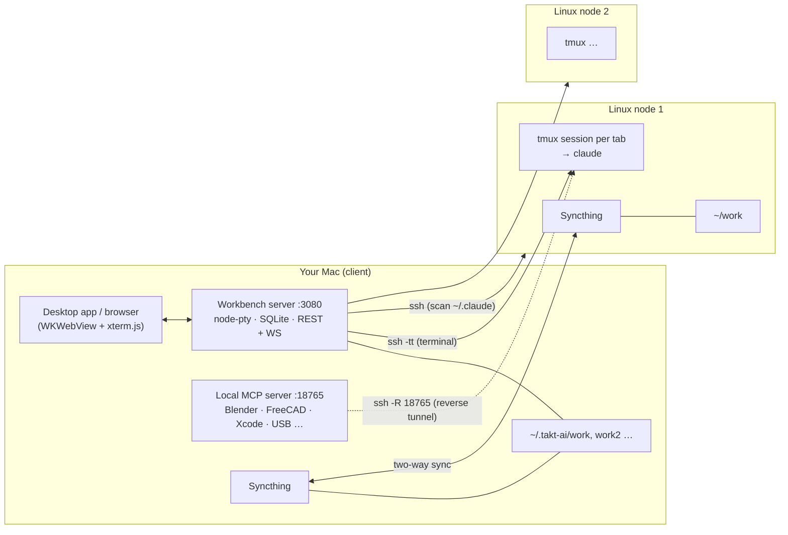

<div align="center">

# TAKT-UI-CC

**A multi-machine workbench for [Claude Code](https://docs.claude.com/claude-code) over SSH.**
One window for all your Linux servers: projects & conversations in a sidebar, persistent terminals,
local file preview, two-way file sync — and a local MCP server your remote Claude can call back into.

[简体中文](README.zh-CN.md) · [Setup guide](docs/SETUP.md) · [Architecture](docs/ARCHITECTURE.md) · [Configuration](docs/CONFIGURATION.md) · [MCP tools](docs/MCP-TOOLS.md) · [Security](docs/SECURITY.md)


</div>

> The UI language is currently **Chinese (简体中文)**. All code, configuration and docs are in English/Chinese; contributions that add an i18n layer are very welcome.

---

## Why

Claude Code runs best on a server (good network, always on, close to your data). But then you juggle SSH windows,
lose track of which conversation lives on which machine, and your local tools (Blender, FreeCAD, Xcode, USB boards…)
are out of reach. TAKT-UI-CC fixes that:

| | |
|---|---|
| **Many machines, one UI** | Connect any number of Linux hosts. Every project and conversation is tagged with the machine it lives on (`HOME`, `GPU`, …). |
| **Conversation sidebar** | Projects → conversations, discovered passively from each server's `~/.claude/projects/*.jsonl`. Rename, delete, tag, filter by machine or tag. Backed by a local **SQLite** database, so the list never flickers or loses entries when a server is offline. |
| **Immortal terminals** | Every tab is `ssh` + a remote **tmux** session. Close the app, lose Wi-Fi, reboot your laptop — reopen and you are back in the same session. Auto-reconnect on network drops. |
| **Local file preview** | The right-hand file tree and preview read the **local mirror** of the server's work folder (kept in sync by Syncthing), so opening images/HTML/code is instant and works even if the server is slow. Drag files in/out of the terminal. |
| **Per-machine work folders** | Machine 1 ↔ `~/.takt-ai/work`, machine 2 ↔ `~/.takt-ai/work2`, … each with its own Syncthing folder. |
| **Reverse MCP tunnel** | A local MCP server (23 tools: Blender, FreeCAD, EasyEDA/JLC EDA, Chrome, Xcode + iPhone deploy, USB/serial, MCU flashing, screen capture, host shell…) is reverse-tunnelled (`ssh -R`) to every node, so Claude running *remotely* can drive *your* machine. Protected by a token, loopback-only. |
| **Project tags** | Antigravity-style colour tags to group projects (Work / Side project / ML …) and filter the sidebar. |
| **Status bar** | Live SSH latency, Tailscale, MCP tunnel and Syncthing state across all nodes, with one-click tunnel self-heal. |

## How it fits together



More detail: [docs/ARCHITECTURE.md](docs/ARCHITECTURE.md).

## Requirements

**On your Mac (client):**
- macOS 13+ (the desktop app and most MCP tools are macOS-only; the web UI itself also runs on Linux in a browser)
- **Node.js ≥ 22.13** (uses the built-in `node:sqlite`) — `brew install node`
- `ssh` with key-based login to your servers (entries in `~/.ssh/config`)
- Xcode command line tools (only to build the native app / compile `node-pty` when no prebuild exists): `xcode-select --install`
- *Optional:* [Syncthing](https://syncthing.net) (`brew install syncthing`) for the local file mirror

**On each Linux server:**
- `tmux`, `python3`, `curl`, and **Claude Code** installed for the SSH user
- *Optional:* `syncthing` — a helper script installs tmux/python3/syncthing for you: [`scripts/remote-bootstrap.sh`](scripts/remote-bootstrap.sh)

## Quick start

```bash
git clone https://github.com/willwill85/TAKT-UI-CC.git
cd TAKT-UI-CC

bash scripts/install.sh          # checks prerequisites + npm install
bash scripts/start.sh            # starts the workbench (:3080) and the local MCP server (:18765)
open http://127.0.0.1:3080       # or build the native app below
```

1. Make sure `ssh my-server` logs in **without a password prompt** (see [SETUP](docs/SETUP.md#1-ssh-access)).
2. In the UI click the **节点 (Nodes)** button (server icon, top-left) → pick your SSH host from the list (read from `~/.ssh/config`) → **Save**.
   TAKT creates the local folder, registers it with Syncthing, opens the MCP reverse tunnel and configures Claude Code on the server — automatically.
3. Create a project with the folder-plus icon (top-left), hover a project and click **＋** to open a terminal on that server, then press **注入终端** to run `claude` (resumed conversations use `claude -r <id>`). TAKT never starts `claude` behind your back — it only opens a shell in tmux and offers the command.

### Native macOS app (optional)

```bash
bash scripts/build-app.sh                       # → build/TAKT-UI-CC.app
cp -R build/TAKT-UI-CC.app /Applications/
```

The app is a WKWebView + native [SwiftTerm](https://github.com/migueldeicaza/SwiftTerm) terminal. It is ad-hoc signed, so on first launch use **right-click → Open**. It starts the background services itself.

### Everyday commands

| Command | What it does |
|---|---|
| `npm run start:all` / `bash scripts/start.sh` | Start workbench + MCP server (idempotent, survives closing the terminal) |
| `npm run stop` | Stop both and close the MCP tunnels (remote tmux sessions keep running) |
| `npm run doctor` | Diagnose local setup and every node (ssh, tmux, claude, MCP tunnel…) |
| `bash scripts/remote-bootstrap.sh` | Install tmux/python3/syncthing on a Linux server (`ssh host 'bash -s' < scripts/remote-bootstrap.sh`) |

## Configuration (short)

Everything is driven by environment variables; defaults work out of the box. Put overrides in `~/.takt-ai/env` (`KEY=value` per line).

| Variable | Default | Meaning |
|---|---|---|
| `TAKT_HOME` | `~/.takt-ai` | Data dir: `nodes.json`, SQLite DB, logs, per-node work folders, MCP token |
| `TAKT_PORT` | `3080` | Web UI / API port (bound to `127.0.0.1`) |
| `TAKT_MCP_PORT` | `18765` | Local MCP server port (bound to `127.0.0.1`) |
| `TAKT_AUTO_ALLOW_HOST_EXEC` | *(unset)* | Set to `1` to pre-approve the `mac_host_exec` tool on remotes (otherwise Claude asks every time) |

Full list: [docs/CONFIGURATION.md](docs/CONFIGURATION.md).

## Security model (read this)

The MCP server can run commands on your Mac, so it is locked down by default:

- Binds to **127.0.0.1 only**; remote nodes reach it exclusively through the SSH reverse tunnel.
- `/mcp` requires `Authorization: Bearer <token>` (random token in `~/.takt-ai/mcp-token`, mode 0600, written into each node's `~/.claude.json`).
- No CORS headers, `Host`/`Origin` validation on every request — websites in your browser cannot talk to it (DNS-rebinding / CSRF safe).
- `mac_host_exec` is set to **ask** in the remote's Claude permissions unless you opt in.
- The workbench itself also only listens on loopback and rejects foreign `Host`/`Origin`.

Anyone who can log in to a connected Linux node as the SSH user can reach the tunnel and (with the token, which is readable from that user's `~/.claude.json`) call MCP tools. Only connect machines you trust. Details: [docs/SECURITY.md](docs/SECURITY.md).

## Repository layout

```
TAKT-UI-CC/
├── config.js                 shared paths/ports/token (env-driven)
├── server/
│   ├── server.js             workbench: REST API, WebSocket terminals, SQLite state, node provisioning
│   ├── native-ssh-session.sh ssh + remote tmux launcher with auto-reconnect
│   └── public/               single-page UI (index.html) + vendored xterm.js
├── mcp-server/server.js      local MCP server + multi-node tunnel/Syncthing watchdog
├── desktop/                  Swift package: native macOS shell (WKWebView + SwiftTerm)
├── scripts/                  install · start · stop · doctor · build-app · remote-bootstrap
├── docs/                     architecture, setup, configuration, MCP tools, security (+ 简体中文)
└── examples/nodes.example.json
```

## Troubleshooting

`npm run doctor` finds most problems. Common ones: [docs/SETUP.md#troubleshooting](docs/SETUP.md#troubleshooting).

## Credits & licence

MIT — see [LICENSE](LICENSE). Bundles [xterm.js](https://github.com/xtermjs/xterm.js) (MIT); uses [node-pty](https://github.com/microsoft/node-pty), [ws](https://github.com/websockets/ws) and [SwiftTerm](https://github.com/migueldeicaza/SwiftTerm) (MIT). Third-party notices: [THIRD_PARTY_NOTICES.md](THIRD_PARTY_NOTICES.md).
