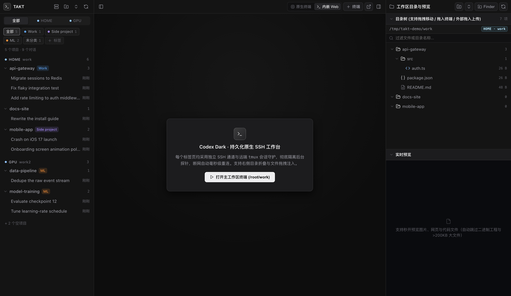
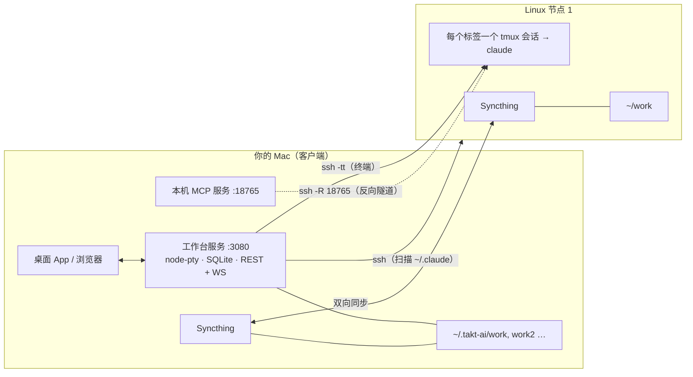

<div align="center">

# TAKT-UI-CC

**为 [Claude Code](https://docs.claude.com/claude-code) 打造的多机 SSH 工作台。**
一个窗口管理所有 Linux 服务器：左侧项目 / 对话树、永不断线的终端、本地文件预览、双向文件同步，
以及一个远端 Claude 可以反向调用的**本机 MCP 服务**。

[English](README.md) · [使用指南](docs/zh-CN/SETUP.md) · [架构说明](docs/zh-CN/ARCHITECTURE.md) · [配置项](docs/CONFIGURATION.md) · [MCP 工具](docs/MCP-TOOLS.md) · [安全说明](docs/SECURITY.md)



</div>

---

## 它解决什么问题

Claude Code 最适合跑在服务器上（网络好、常驻、离数据近）。但这样你要同时开很多 SSH 窗口，
分不清哪个对话在哪台机器上，本机的工具（Blender、FreeCAD、Xcode、USB 开发板……）也够不着。TAKT-UI-CC 把这些都接起来：

| | |
|---|---|
| **多机一个界面** | 可连任意多台 Linux。每个项目和对话都带机器徽标（如 `HOME`、`GPU`），一眼看出在哪台。 |
| **对话侧边栏** | 项目 → 对话，直接被动扫描各服务器的 `~/.claude/projects/*.jsonl`；支持重命名、删除、打标签、按机器/标签筛选。状态存在本机 **SQLite**，服务器离线或网络抖动时列表也不会闪烁、不会丢。 |
| **永不断线的终端** | 每个标签页 = `ssh` + 远端 **tmux** 会话。关掉应用、断网、合盖，重开就回到原会话；网络闪断自动重连。 |
| **本地文件预览** | 右侧文件树/预览读取服务器工作目录在本机的**镜像**（Syncthing 双向同步），图片/网页/代码秒开；支持把文件拖进终端。 |
| **每台机器独立工作目录** | 机器 1 ↔ `~/.takt-ai/work`，机器 2 ↔ `~/.takt-ai/work2` …… 各自独立的 Syncthing 文件夹。 |
| **反向 MCP 隧道** | 本机 MCP 服务（23 个工具：Blender、FreeCAD、嘉立创 EDA、Chrome、Xcode + iPhone 真机部署、USB/串口、MCU 烧录、截屏、本机 Shell……）通过 `ssh -R` 反向映射到每台服务器，**远端的 Claude 可以操控你的本机**。仅监听回环地址 + Token 鉴权。 |
| **项目标签** | 仿 Antigravity 的彩色标签（工作 / 业余 / 实验……），按标签筛选侧边栏。 |
| **状态栏** | 实时显示所有节点的 SSH 延迟、Tailscale、MCP 隧道、Syncthing 状态，一键自愈。 |

> 当前界面语言为**简体中文**。欢迎提交 i18n 改造。

## 架构一图流



## 环境要求

**本机（Mac）：**
- macOS 13+（桌面 App 与多数 MCP 工具仅 macOS；Web 界面本身也可在 Linux 浏览器运行）
- **Node.js ≥ 22.13**（使用内置 `node:sqlite`）：`brew install node`
- `ssh`，且能用**密钥免密登录**服务器（配置在 `~/.ssh/config`）
- Xcode 命令行工具（编译原生 App / 无预编译时编译 `node-pty`）：`xcode-select --install`
- *可选：* [Syncthing](https://syncthing.net)（`brew install syncthing`），用于本地文件镜像

**每台 Linux 服务器：**
- `tmux`、`python3`、`curl`，并为登录用户装好 **Claude Code**
- *可选：* `syncthing`。可用 [`scripts/remote-bootstrap.sh`](scripts/remote-bootstrap.sh) 一键安装 tmux / python3 / syncthing

## 快速开始

```bash
git clone https://github.com/willwill85/TAKT-UI-CC.git
cd TAKT-UI-CC

bash scripts/install.sh          # 检查依赖 + npm install
bash scripts/start.sh            # 启动工作台 (:3080) 与本机 MCP 服务 (:18765)
open http://127.0.0.1:3080       # 或构建下方的原生 App
```

1. 先确认 `ssh my-server` **无需输入密码**即可登录（见 [使用指南](docs/zh-CN/SETUP.md#1-ssh-免密登录)）。
2. 界面左上角点 **节点**（服务器图标）→ 从列表选一个 SSH 主机（读取自 `~/.ssh/config`）→ 保存。
   TAKT 会**自动**创建本地目录、注册 Syncthing、建立 MCP 反向隧道、并在服务器上配置好 Claude Code。
3. 用左上角“新建文件夹”图标建项目；鼠标悬停项目点 **＋** 在该服务器打开终端，再点 **注入终端** 运行 `claude`（恢复历史对话则是 `claude -r <id>`）。TAKT 不会在你背后自动启动 `claude`，只开 tmux shell 并给出命令。

### 原生 macOS App（可选）

```bash
bash scripts/build-app.sh                       # → build/TAKT-UI-CC.app
cp -R build/TAKT-UI-CC.app /Applications/
```

App = WKWebView + 原生 [SwiftTerm](https://github.com/migueldeicaza/SwiftTerm) 终端，采用 ad-hoc 签名，首次打开请**右键 → 打开**。App 会自己拉起后台服务。

### 常用命令

| 命令 | 作用 |
|---|---|
| `npm run start:all` / `bash scripts/start.sh` | 启动工作台 + MCP 服务（幂等；关闭终端不会杀掉服务） |
| `npm run stop` | 停止两者并关闭 MCP 隧道（远端 tmux 会话继续运行） |
| `npm run doctor` | 诊断本机与每个节点（ssh、tmux、claude、MCP 隧道……） |
| `bash scripts/remote-bootstrap.sh` | 在 Linux 上安装 tmux/python3/syncthing：`ssh 主机 'bash -s' < scripts/remote-bootstrap.sh` |

## 配置（简版）

全部通过环境变量配置，默认值开箱即用。覆盖项写进 `~/.takt-ai/env`（每行 `KEY=value`）。

| 变量 | 默认 | 含义 |
|---|---|---|
| `TAKT_HOME` | `~/.takt-ai` | 数据目录：`nodes.json`、SQLite、日志、各节点 work 目录、MCP Token |
| `TAKT_PORT` | `3080` | Web 界面 / API 端口（仅监听 `127.0.0.1`） |
| `TAKT_MCP_PORT` | `18765` | 本机 MCP 服务端口（仅监听 `127.0.0.1`） |
| `TAKT_AUTO_ALLOW_HOST_EXEC` | 未设置 | 设为 `1` 则在远端预先放行 `mac_host_exec`（默认每次都会询问） |

完整列表见 [docs/CONFIGURATION.md](docs/CONFIGURATION.md)。

## 安全模型（请务必阅读）

MCP 服务能在你的 Mac 上执行命令，因此默认做了收紧：

- 只绑定 **127.0.0.1**；远端节点只能通过 SSH 反向隧道访问。
- `/mcp` 需要 `Authorization: Bearer <token>`（随机 Token 存于 `~/.takt-ai/mcp-token`，权限 0600，并写入各节点的 `~/.claude.json`）。
- 不发送 CORS 头，每个请求校验 `Host` / `Origin` —— 浏览器里的任何网站都无法访问（防 DNS 重绑定 / CSRF）。
- 远端 Claude 的权限里，`mac_host_exec` 默认设为**询问**，除非你主动开启自动放行。
- 工作台本身同样只监听回环地址，并拒绝陌生 `Host` / `Origin`。

能以对应 SSH 用户登录某个已连接节点的人，可以访问隧道，并读取该用户 `~/.claude.json` 里的 Token 来调用 MCP 工具。**只连接你信任的机器。** 详见 [docs/SECURITY.md](docs/SECURITY.md)。

## 目录结构

```
TAKT-UI-CC/
├── config.js                 共享的路径 / 端口 / Token（环境变量驱动）
├── server/
│   ├── server.js             工作台：REST API、WebSocket 终端、SQLite 状态、节点自动配置
│   ├── native-ssh-session.sh ssh + 远端 tmux 启动器（含自动重连）
│   └── public/               单页界面 index.html + 内置 xterm.js
├── mcp-server/server.js      本机 MCP 服务 + 多节点隧道 / Syncthing 看门狗
├── desktop/                  Swift 包：原生 macOS 外壳（WKWebView + SwiftTerm）
├── scripts/                  install · start · stop · doctor · build-app · remote-bootstrap
├── docs/                     架构、使用指南、配置、MCP 工具、安全（含简体中文）
└── examples/nodes.example.json
```

## 排错

`npm run doctor` 能定位大部分问题。常见问题见 [docs/zh-CN/SETUP.md#排错](docs/zh-CN/SETUP.md#排错)。

## 许可

MIT，见 [LICENSE](LICENSE)。内置 [xterm.js](https://github.com/xtermjs/xterm.js)（MIT）；依赖 [node-pty](https://github.com/microsoft/node-pty)、[ws](https://github.com/websockets/ws)、[SwiftTerm](https://github.com/migueldeicaza/SwiftTerm)（MIT）。第三方声明见 [THIRD_PARTY_NOTICES.md](THIRD_PARTY_NOTICES.md)。
