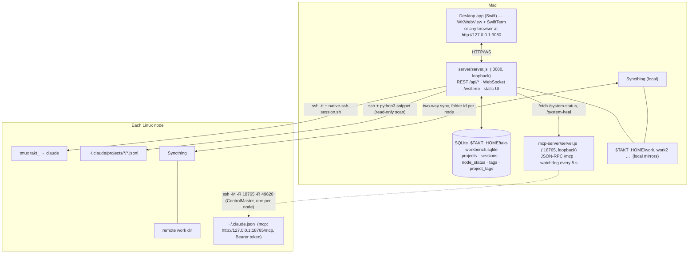

# Architecture

> 简体中文版: [zh-CN/ARCHITECTURE.md](zh-CN/ARCHITECTURE.md)

TAKT-UI-CC has three runtime pieces on your Mac and a very small footprint on each server.



## 1. Node registry

`$TAKT_HOME/nodes.json` is the single source of truth for machines:

```json
{ "nodes": [{
  "id": "node-1", "name": "Home Server", "badge": "HOME",
  "sshHost": "home-server",                 // alias from ~/.ssh/config
  "remoteWorkDir": "/home/dev/work",        // where projects live on the server
  "localWorkDir": "/Users/me/.takt-ai/work",// its local mirror
  "localWorkAlias": "work",
  "syncthingFolderId": "takt-work",
  "syncthingDeviceId": "XXXXXXX-…",         // filled in automatically
  "enabled": true
}]}
```

Each node owns **one** local folder, **one** Syncthing folder id and **one** tunnel socket (`~/.ssh/sockets/takt-mcp-tunnel-<id>.sock`). The first node (`node-1`) cannot be deleted; additional ones get generated ids (`linux-xxxxxxxx`).

### Provisioning (what "Save node" does)

`provisionLinuxNode()` in `server/server.js`:

1. creates the local folder and registers it as a Syncthing folder (Mac side);
2. builds the MCP reverse tunnel: `ssh -M -S <sock> -Nf -R 18765:127.0.0.1:18765 -R 49620:127.0.0.1:49620 <host>`;
3. runs a small `python3` snippet on the server that
   - creates the remote work dir (falls back to `~/Documents/work` / `~/work` for non-root users),
   - writes the `mac-industrial` MCP server (URL + `Authorization: Bearer <token>`) into `~/.claude.json`,
   - adds `mcp__mac-industrial` to `permissions.allow` and `mac_host_exec` to `permissions.ask` in `~/.claude/settings.json`,
   - reports the server's Syncthing device id;
4. **pairs Syncthing in both directions** using each side's local REST API (`PUT /rest/config/devices/<id>` + `PUT /rest/config/folders/<id>`), so files start syncing without manual steps.

## 2. Sidebar data: passive scanning + SQLite

The sidebar never talks to the `claude` binary. For every enabled node, `syncAllNodesToSqlite()` runs a read-only `python3` snippet over `ssh` that

- lists the first-level folders of the remote work dir (= projects),
- samples `~/.claude/projects/*/*.jsonl` (head + tail of each file) to get the session id, custom title / summary / first prompt, turn count, size and mtime,
- normalises deep working directories (`/work/proj/repos/x`) to the top-level project folder.

Results are **upserted** into SQLite:

| Table | Purpose |
|---|---|
| `projects(key, node_id, path, local_path, name, pinned_visible, deleted, updated_at)` | `key = <node id>::<remote path>` |
| `sessions(id, node_id, project_path, title, custom_title, last_prompt, turns, size_bytes, updated_at, deleted)` | renames are `custom_title`, deletes are soft |
| `node_status(node_id, online, last_sync_at)` | last known reachability |
| `tags(id, name, color, sort, created_at)` / `project_tags(project_key, tag_id)` | sidebar tags (one tag per project) |

`GET /api/tree` is answered **from SQLite in <1 ms**; a background sync refreshes it at most every ~6 s. A failed scan (server offline, ssh blip) never deletes anything — that is why the list is stable. Empty projects are hidden unless they have a tag, were created in the UI, or were just opened.

## 3. Terminals

Two interchangeable engines (switch in the top bar):

- **Native** (desktop app): `LocalProcessTerminalView` (SwiftTerm) runs `native-ssh-session.sh` directly; the web page only reports the rectangle to draw into (`taktNative` message handler).
- **Web PTY**: the browser's xterm.js talks to `WS /ws/term`; the server spawns the same script under `node-pty`, keeps a 256 KB scrollback per tab and multiplexes several clients.

`native-ssh-session.sh <tab> <cwd> <host>` runs `ssh -tt` with `ControlMaster=no` and `ClearAllForwardings=yes` (terminals never share or disturb the tunnel), then on the server creates/attaches tmux session `takt_<tab>` in the project folder. SSH exit 255 (network drop) reconnects automatically; four consecutive instant failures stop and wait for Enter instead of looping.

## 4. File area

Right-hand tree and preview use the **local mirror** only (`/api/files`, `/api/file-content`, `/api/raw-file`). Paths coming from the terminal (`/home/dev/work/x/y.png`) are mapped to the mirror by comparing against each node's `remoteWorkDir`. Preview limits: images ≤ 12 MB, HTML ≤ 2 MB, code/text ≤ 200 KB, binaries skipped. Mutating endpoints (`move`, `upload`, `mkdir`) refuse any path outside `$TAKT_HOME`.

## 5. MCP server and watchdog

`mcp-server/server.js --http` speaks MCP (JSON-RPC 2.0) on `POST /mcp` (also SSE: `GET /sse` + `POST /messages`). The `?node=<id>` query parameter tells it which node is calling so remote paths (`<remoteWorkDir>/foo`) are translated to that node's local mirror. Other endpoints: `/health`, `/system-status` (JSON for the status bar), `POST /system-heal`, `/viewer` (3D viewer), `/work/*` (read-only files).

Every 5 s the **watchdog**:

1. checks the EasyEDA bridge and Syncthing (aggregated over all nodes' folders/devices);
2. for each enabled node probes it through the node's ControlMaster socket with a `python3` script (claude processes, MCP reachability from the server's side, egress IP, Tailscale, usage estimate);
3. if the MCP tunnel is not usable, rebuilds it (at most once per 15 s per node) — only the dedicated tunnel socket is touched, never an interactive terminal;
4. publishes everything via `/system-status`; the workbench merges it into `/api/status` for the bottom bar.

## 6. Security boundaries

See [SECURITY.md](SECURITY.md). In short: both HTTP servers listen on loopback only, validate `Host`/`Origin`, `/mcp` needs a bearer token, and the tunnel is the only path from a server to your Mac.

## 7. Process model

`scripts/start.sh` launches `mcp-server` and `workbench` as detached processes (new session via `setsid`), writes pid files to `$TAKT_HOME/run/` and logs to `$TAKT_HOME/logs/`. The workbench also supervises the MCP server (restarts it if `/system-status` stops answering).
